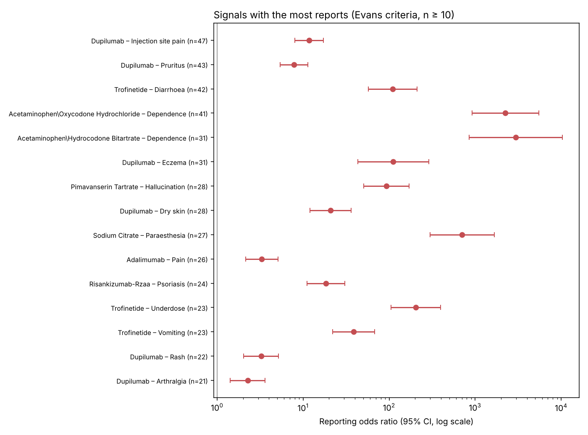
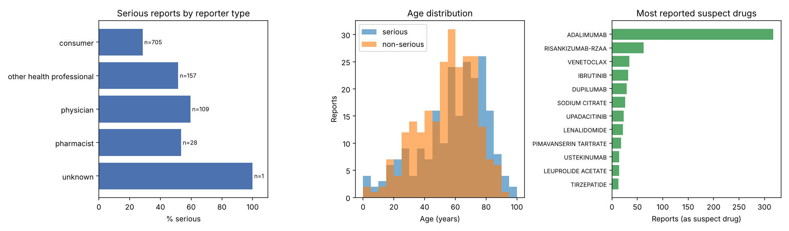

# Pharmacovigilance on FDA adverse-event reports: signal detection and seriousness prediction

A reproducible Python pipeline on real-world adverse-event reports from the FDA Adverse Event
Reporting System (**FAERS**, via the openFDA API). It does two things:

1. **Safety signal detection.** Disproportionality analysis (PRR, ROR) finds drug–reaction pairs
   that are reported more often than expected.
2. **Seriousness prediction.** A classifier predicts whether a report is *serious*, so incoming
   reports can be triaged. Preprocessing, oversampling and tuning are leakage-free.

> ⚠️ **Educational analysis, not for clinical or regulatory use.** FAERS reports do not show that a
> drug caused an event, and they are affected by duplicates, under-reporting and stimulated reporting.

## Data

**Sample.** 20 reports for every day of 2023, received 2023-01-01 to 2023-12-31, downloaded with
`run_pipeline.py fetch`. This gives 7,295 report IDs. One small request per day spreads the sample
over the whole year; a single large query returns reports in the API's default order, which come
from only a few days.

**Deduplication.** 331 probable duplicate cases were removed: different report IDs with the same
suspect drugs, reactions, age, sex and country. This leaves **6,964 reports, 59.3% serious**.

**Stored data.** The trimmed sample is included in `data/faers_reports.jsonl.gz` (0.7 MB), so the
analysis runs without an API key.

## 1. Signal detection

For each (suspect drug, reaction) pair, a 2 × 2 table of report counts gives:

- **PRR**, the proportional reporting ratio;
- **ROR**, the reporting odds ratio, with a 95% CI.

**Signal criteria.** A pair is a signal if it has ≥ 3 reports, PRR ≥ 2 and χ² ≥ 4 (with Yates'
correction), as in Evans et al. (2001).

**Corrections and exclusions.**

- If any cell of the table is zero, 0.5 is added to all four cells, so ratios stay finite.
- These MedDRA terms are excluded, because they do not describe a clinical reaction:
  - product-quality, device and use-process terms (e.g. *Product quality issue*, *Device difficult to
    use*, *Off label use*);
  - outcomes (*Death*, *Hospitalisation*);
  - *Ill-defined disorder*.

**Signals with the most reports.** 1,800 of the 2,103 pairs with ≥ 3 reports meet the criteria. The
15 signals with the most reports (full list in [`results/signals.csv`](results/signals.csv)):



| Drug | Reaction | Reports | PRR | ROR [95% CI] |
|---|---|---|---|---|
| Dupilumab | Injection site pain | 47 | 10.4 | 11.7 [8.0–17.1] |
| Dupilumab | Pruritus | 43 | 7.1 | 7.8 [5.4–11.4] |
| Trofinetide | Diarrhoea | 42 | 25.2 | 110.0 [57.1–212.0] |
| Acetaminophen/oxycodone | Dependence | 41 | 405.0 | 2245.2 [920.3–5477.9] |
| Acetaminophen/hydrocodone | Dependence | 31 | 263.3 | 2973.4 [851.0–10389.0] |
| Dupilumab | Eczema | 31 | 103.1 | 111.8 [43.2–289.2] |
| Pimavanserin | Hallucination | 28 | 73.0 | 92.6 [50.5–169.7] |
| Dupilumab | Dry skin | 28 | 19.4 | 20.8 [11.9–36.3] |
| Sodium citrate | Paraesthesia | 27 | 162.0 | 705.3 [298.5–1666.5] |
| Adalimumab | Pain | 26 | 3.1 | 3.3 [2.2–5.1] |
| Risankizumab | Psoriasis | 24 | 16.2 | 18.3 [11.0–30.5] |
| Trofinetide | Underdose | 23 | 117.7 | 204.3 [104.8–398.2] |
| Trofinetide | Vomiting | 23 | 22.6 | 38.7 [22.0–68.2] |
| Dupilumab | Rash | 22 | 3.1 | 3.3 [2.0–5.2] |
| Dupilumab | Arthralgia | 21 | 2.2 | 2.3 [1.4–3.6] |

**How to read these**

- **Known adverse reactions are recovered.**
  - Diarrhoea and vomiting are the most common adverse reactions in the trofinetide (Daybue) label.
  - Injection site reactions are listed in the dupilumab (Dupixent) label.
  - Opioid–dependence signals match the known addiction risk of opioids.
- **Several signals are confounding by indication, not adverse reactions.** The reaction is the
  disease the drug treats:
  - eczema and dupilumab, which is indicated for atopic dermatitis;
  - psoriasis and risankizumab;
  - hallucination and pimavanserin, which is indicated for hallucinations and delusions in Parkinson's
    disease psychosis.

  A reviewer would remove these by checking the indication.
- **Most small pairs are flagged.** That 86% of pairs with ≥ 3 reports meet the criteria shows that
  the Evans thresholds, designed for national databases with far more reports, are permissive on a
  sample of 7,000. Pairs with 3–9 reports often come from one patient's repeated reports and get
  very large, unstable ratios. For example, felodipine and isosorbide dinitrate appear with the same
  reactions in 3 near-identical reports that the simple deduplication did not catch.

## 2. Seriousness prediction

**Features.**

- Age, weight, sex, reporter type and country;
- number of drugs and reactions;
- multi-hot suspect drugs and MedDRA reaction terms (each seen in ≥ 5 training reports).

**Main analysis without outcome terms.** Reaction terms that restate a seriousness criterion (e.g.
*Death*, *Hospitalisation*) are removed in the main analysis. They are kept only in an ablation.

**Evaluation.**

- Stratified 75 / 25 train/test split.
- Hyperparameters are tuned with 5-fold `GridSearchCV` on the training set only, scored by AUPRC.
- The decision threshold maximises F1 on out-of-fold training predictions.
- 95% CIs come from 1,000 bootstrap resamples of the test set (n = 1,741).

| Model (test set) | AUROC [95% CI] | AUPRC [95% CI] | Precision | Recall | F1 |
|---|---|---|---|---|---|
| Majority class (baseline) | 0.500 | 0.593 | 0.593 | 1.000 | 0.744 |
| **Logistic regression (class-weighted)** | **0.947 [0.936–0.955]** | **0.965 [0.957–0.972]** | 0.891 | 0.889 | 0.890 |
| Random forest (class-weighted) | 0.938 [0.926–0.947] | 0.952 [0.937–0.963] | 0.875 | 0.911 | 0.893 |
| Random forest + SMOTE | 0.937 [0.924–0.946] | 0.951 [0.935–0.963] | 0.892 | 0.885 | 0.888 |



- **Logistic regression is the best model.** Its AUROC CI only just overlaps those of the random
  forests, and its AUPRC is higher.
- **SMOTE adds nothing over class weighting.** With 59% serious reports, the classes are only
  mildly imbalanced.
- **Outcome terms add little.** Keeping them raises logistic regression AUROC only from 0.947 to
  0.956 (all numbers in [`results/summary.md`](results/summary.md)). The model does not depend on
  terms that restate the label.
- **Reporter type matters.** 50% of consumer reports are serious, against 68–71% of reports from
  physicians and other health professionals (figure, left).

## How it works

```text
openFDA API ──► fetch (20 reports/day, trimmed fields) ──► data/faers_reports.jsonl.gz
                                                              │
                                     parse + deduplicate ◄────┘
                                       │                │
             disproportionality (PRR, ROR, χ²)   imblearn Pipeline per model:
             → results/signals.csv                 impute · scale · one-hot · multi-hot drugs/reactions
                                                   (· SMOTE) · classifier
                                                   GridSearchCV on train only → test + bootstrap CI
```

**No leakage.** Vocabularies, imputation, scaling and SMOTE are pipeline steps. Cross-validation and
grid search refit them on every training fold, so SMOTE never creates synthetic samples from
validation or test reports.

## Run it

```bash
pip install -r requirements.txt
python run_pipeline.py run                                              # uses the bundled 2023 sample
python run_pipeline.py fetch --start 20240101 --end 20241231 --per-day 20   # optional: new sample
python -m pytest -q tests
```

**API key.** An openFDA API key is optional. If you have one, set it as the `OPENFDA_API_KEY`
environment variable; it is never written to disk.

**CI.** The GitHub Actions workflow runs the tests on every push. The full analysis (download, run,
commit results) runs when started from the Actions tab.

## Changes from the first version

- **The data script was broken.** It was truncated mid-line (syntax error), and the README referred
  to `pipeline.py`, which did not exist.
- **Tuning was leaky.** SMOTE was applied before `GridSearchCV`, so synthetic samples built from
  validation folds were used to choose hyperparameters. SMOTE is now inside the cross-validated
  pipeline.
- **More data.** The model used only age, sex and the first drug name, on 304 reports from two days.
  It now uses reactions, all suspect drugs, reporter type and country, on 6,964 reports from 365 days.
- **Real signal detection.** "Safety signal detection" was only a classifier. PRR and ROR
  disproportionality analysis is now implemented.
- **Reported results.** No results were reported before. There are now baselines, bootstrap CIs, an
  outcome-term ablation and tests.

## Limitations

- **Not a random sample.** 20 reports per day is a sample of FAERS, not a random draw. Within a day,
  the API's default order is used.
- **Simple deduplication.** Duplicates are matched on exact key fields. Near-duplicates with small
  differences remain, as the felodipine example shows.
- **Reporter-assigned label.** The `serious` flag is the reporter's regulatory classification, not a
  clinical gold standard.
- **No causality.** Signals are hypotheses for review. Confounding by indication and stimulated
  reporting (for example, reports filed by lawyers: 20 in this sample) can produce them.

## References

- U.S. Food and Drug Administration. openFDA drug adverse event API. <https://open.fda.gov/apis/drug/event/>
- Evans S.J.W., Waller P.C., Davis S. (2001). Use of proportional reporting ratios (PRRs) for signal
  generation from spontaneous adverse drug reaction reports. *Pharmacoepidemiology and Drug Safety*,
  10(6), 483–486. <https://doi.org/10.1002/pds.677>
- Labels used to interpret signals:
  - DAYBUE (trofinetide), [DailyMed](https://dailymed.nlm.nih.gov/dailymed/drugInfo.cfm?setid=67e6f2d9-21f6-466f-9def-826c6a4b8257);
  - DUPIXENT (dupilumab), [prescribing information](https://www.drugs.com/pro/dupixent.html);
  - NUPLAZID (pimavanserin), [prescribing information](https://www.drugs.com/pro/nuplazid.html).
